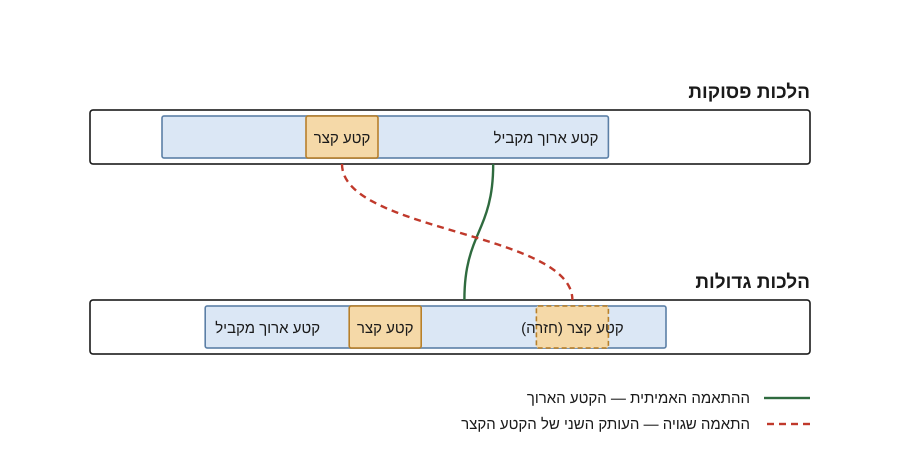

## מה נלמד היום

- מהו טקסט מקביל (text reuse)
- האלגוריתם של שמידמן: skip-grams ואלכסונים
- השיפור: שרשור אלכסונים ל-MSM
- השוואה ל-passim

## הבעיה

שני חיבורים — **הלכות פסוקות** ו**הלכות גדולות** — חולקים קטעי טקסט.
השאלה: איך מזהים אותם אוטומטית?

אתגר מרכזי: הטקסטים אינם זהים. יש הבדלי כתיב, מילים נוספות, ופיצול מילים
(למשל "ביתרי" מול "בי תרי").

## שלבי האלגוריתם

1. פירוק כל טקסט ל-skip-grams
2. סימון כל התאמה כנקודה במרחב דו-מימדי
3. זיהוי "אלכסונים" — רצפים של התאמות
4. שרשור אלכסונים סמוכים ל-MSM

## חזרות בתוך קטע מקביל {.smaller}

כאשר קטע קצר חוזר בתוך קטע ארוך, האלגוריתם עלול להתאים את העותק הלא נכון
(ראו ב-@fig-rep).

{#fig-rep width=85%}

## תוצאות

| מדד | Shmidman | MSM |
|:---|---:|---:|
| מילים מכוסות | 5,859 | 7,779 |
| מספר התאמות | 149 | 134 |
| אורך חציוני | 33 | 42 |

: השוואה בין האלגוריתמים {#tbl-results}

## סיכום

- שרשור אלכסונים מאריך את הקטעים המזוהים ב-33% מילים
- הכיסוי גבוה יותר מ-passim בהרצה שנבדקה
- הכיוון הבא: מיפוי גלובלי ושינויי משמעות
