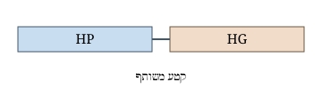

```{=html}
<!-- No lang or dir here on purpose: they come from _quarto.yml, and this
     document is the check that they do. -->
```

# כותרת ראשית

פסקה בעברית עם מונח לטיני משובץ, למשל MSM ו־passim, כדי לבדוק שהגופן לא נשבר באמצע המשפט. הטקסט הזה קיים רק כדי לוודא שהתבנית `hebrew.docx` נטענת, שהגופן דוד מופיע בגוף המסמך, ושאיור SVG נכנס לקובץ ה־Word.

## כותרת משנה

::: {dir="rtl"}
| עמודה  |    ערך |
|--------|-------:|
| התאמות |    233 |
| מילים  | 12,469 |
:::

This paragraph is in no div at all. It starts with a Latin letter, so the first strong character makes it left to right, and its full stop stays on the right where an English sentence expects it.

MSM מוצא קטעים ארוכים יותר מאשר האלגוריתם הקודם. פסקה עברית שנפתחת במונח לטיני נקראת כשמאל־לימין, וזאת החולשה הידועה של הכלל.

::: {dir="rtl"}
MSM מוצא קטעים ארוכים יותר מאשר האלגוריתם הקודם. אותה פסקה, עטופה בדיב שקובע ימין־לשמאל, נקראת נכון.
:::

| Term   | Meaning       |
|--------|---------------|
| passim | text reuse    |
| MSM    | maximal match |



English text